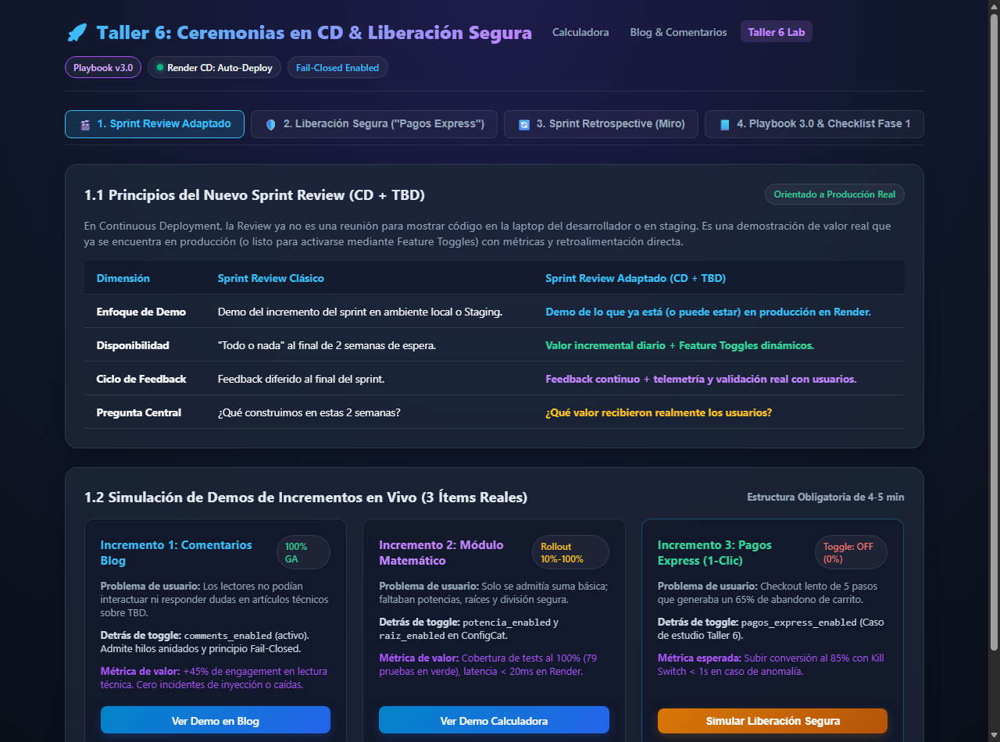
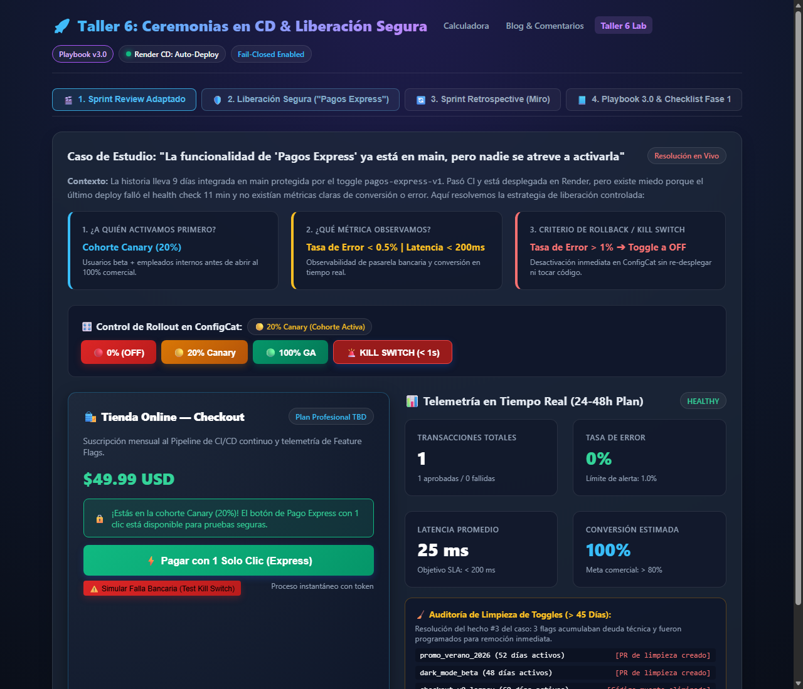
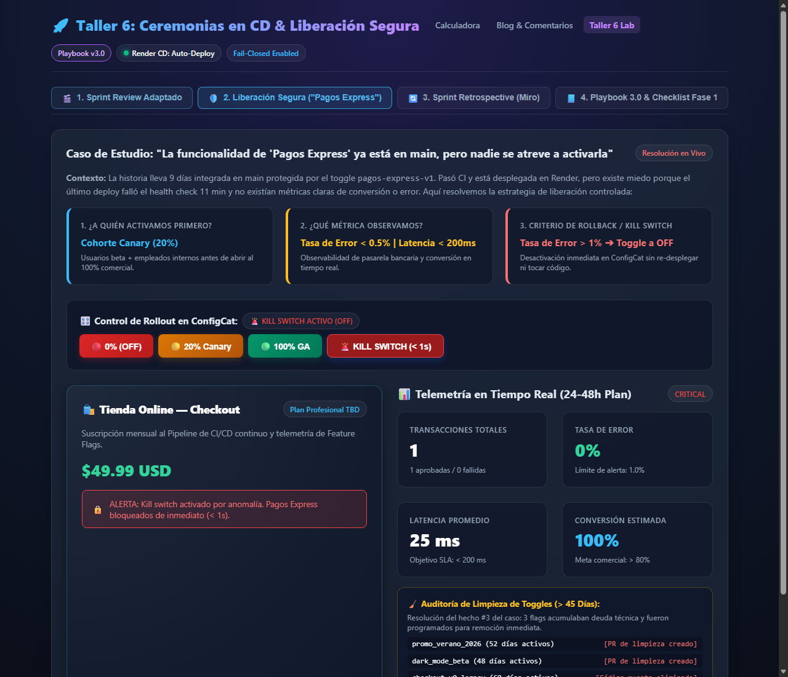
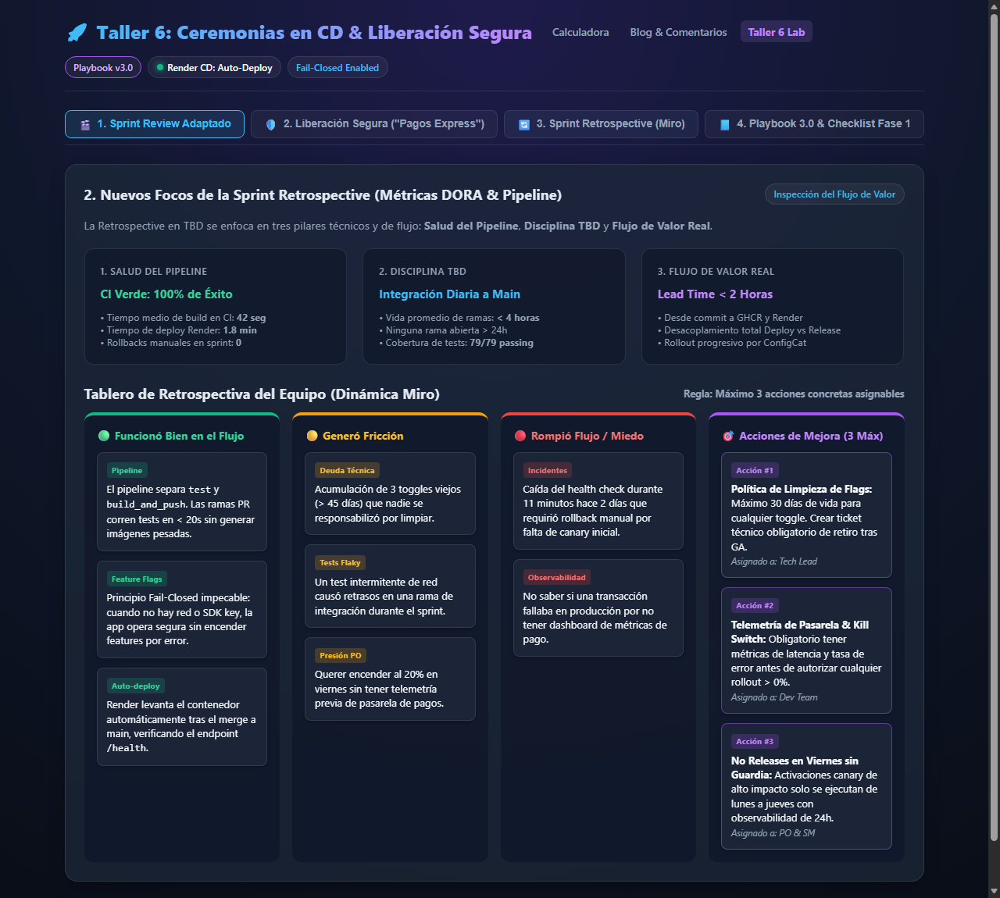
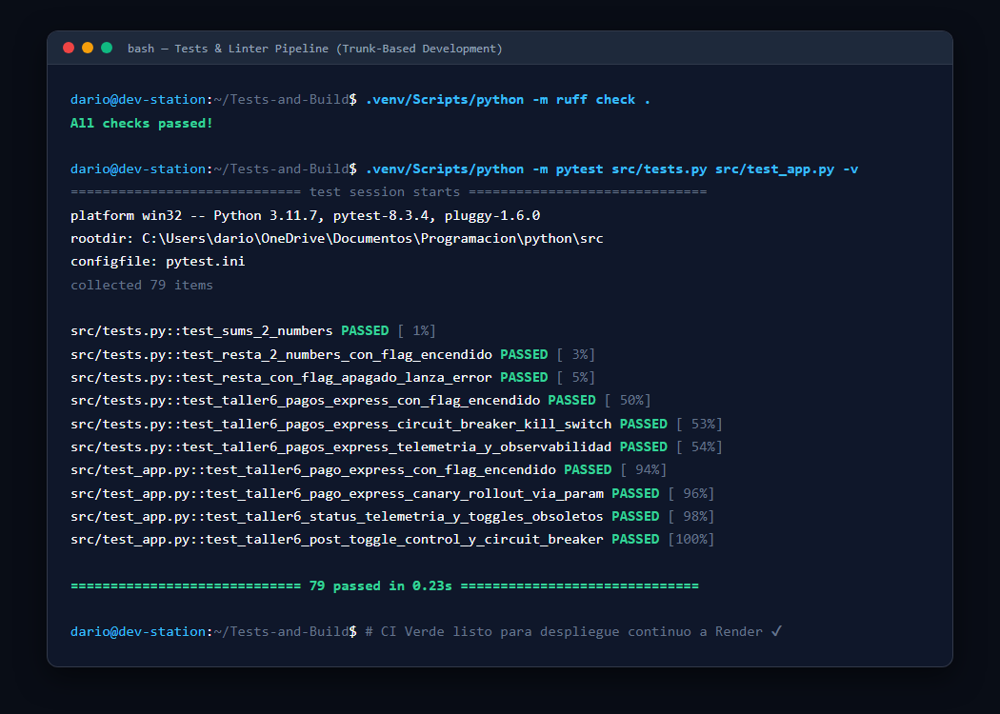
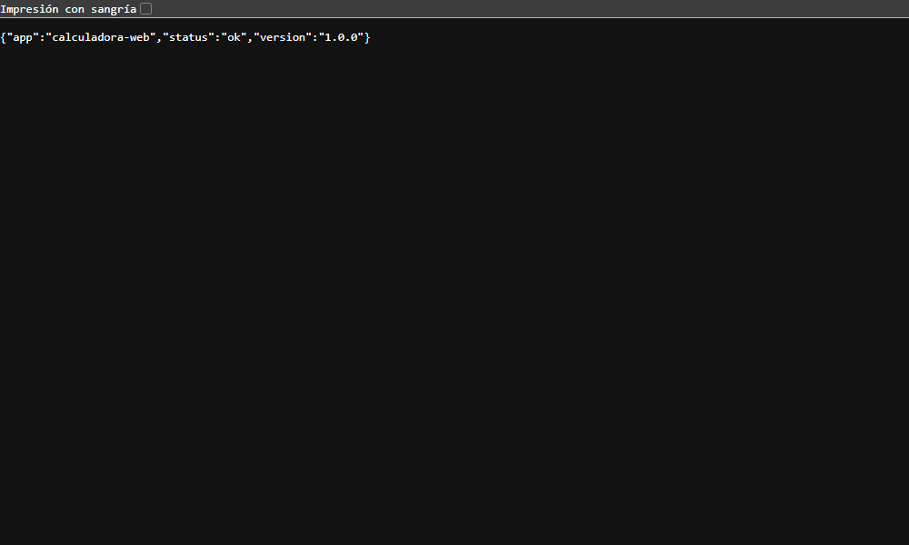
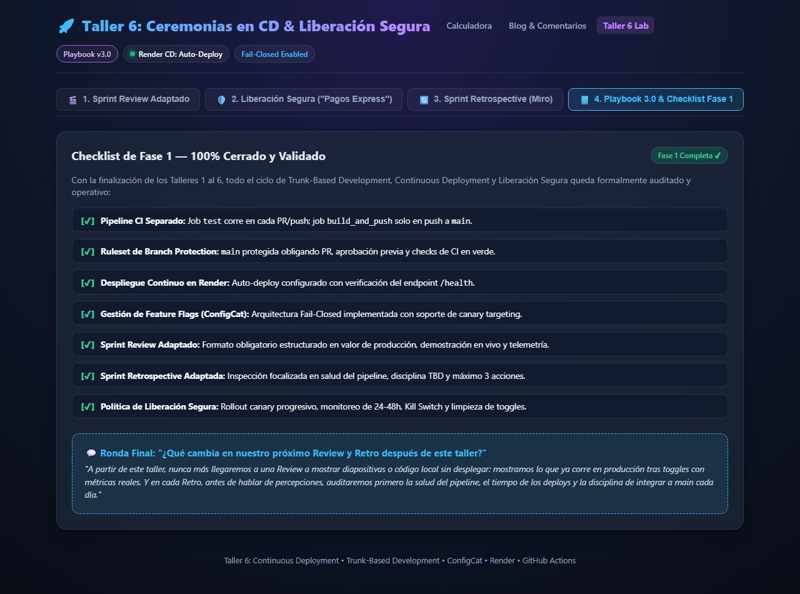

# 🚀 Guía Práctica y Explicativa del Taller 6
### *Sprint Review, Retrospective y Liberación Segura en Continuous Deployment (CD + TBD)*

> **Nota informal para el equipo:**  
> Esta guía resume de manera directa, sencilla y sin rodeos todo lo que se implementó y acordó durante el **Taller 6**. Aquí tienes el paso a paso de lo que se hizo en el proyecto, cómo se resolvieron los problemas y las capturas de pantalla de los momentos más importantes.

---

## 💡 1. ¿De qué va este Taller 6? (En cristiano)

Hasta el Taller 5 teníamos el pipeline armado: el código se prueba con CI, se integra a la rama `main` y se despliega solo a Render, usando Feature Flags con ConfigCat para no romperle nada al usuario.

Pero surgió la gran pregunta:
> *"Si ahora desplegamos varias veces por semana a producción... ¿para qué sirve hacer una Sprint Review cada 2 semanas? ¿Y de qué hablamos en la Retrospective si ya no esperamos al final del sprint para saber si algo falló?"*

El objetivo de este taller fue **adaptar las ceremonias de Scrum** a este nuevo ritmo continuo y practicar una **liberación segura en vivo**, resolviendo el caso real de *"Pagos Express ya está en main, pero nadie se atreve a encenderlo"*.

---

## 🎬 2. La Nueva Sprint Review (Adiós a las demos en localhost)

### ¿Qué cambió?
* **Antes (Scrum clásico):** Nos juntábamos cada 2 semanas a mostrar diapositivas o a correr el proyecto en la máquina de un desarrollador o en un entorno Staging desfasado.
* **Ahora (CD + TBD):** La demo se hace **directamente en producción (Render)**. Mostramos lo que ya está vivo (o lo que está apagado detrás de un Feature Toggle), mostramos números de telemetría reales y le preguntamos al Product Owner y a los interesados: *"¿Esto resuelve el problema y genera el valor que esperaban?"*.

### Estructura obligatoria de cada demo (máximo 4-5 minutos):
1. **¿Qué problema de usuario resuelve?**
2. **¿Está activo para todos o detrás de toggle?**
3. **Demo en vivo en Render** (con toggle ON y OFF para probar el aislamiento Fail-Closed).
4. **Métricas o evidencia de valor**.
5. **Pregunta de feedback al PO/Stakeholders**.

### Los 3 incrementos reales presentados:
1. **Comentarios del Blog:** Soporte de hilos de discusión anidados detrás del flag `comments_enabled` con principio Fail-Closed.
2. **Módulo Matemático Avanzado:** Potenciación y radicación con control de errores numéricos bajo los flags `potencia_enabled` y `raiz_enabled`.
3. **Pagos Express con 1 Clic:** La nueva funcionalidad de checkout seguro con medición de telemetría y Kill Switch.

*Figura 1: Tablero interactivo de Sprint Review con la tabla comparativa y las 3 demos reales preparadas.*

---

## 🛡️ 3. Liberación Segura de Valor y el "Drama" de Pagos Express

### El caso que teníamos que resolver:
La historia *"Pagos Express con un solo clic"* llevaba 9 días integrada en `main` y desplegada en Render protegida por el toggle `pagos-express-v1` (en OFF al 0%).
Había mucha tensión en el equipo por estos 7 hechos:
1. El PO quería encenderla al 20% un **viernes** por presión de marketing.
2. Hace 2 días un deploy automático había botado el health check por 11 minutos y tocó hacer rollback manual.
3. Había 3 Feature Toggles viejos de más de 45 días acumulando polvo y deuda técnica.
4. En el sprint solo se habían hecho 4 integraciones a main (muy por debajo de la integración diaria).
5. Un desarrollador tuvo una rama abierta 4 días por un test *flaky*.
6. No existía ninguna métrica de error o conversión para observar si el pago fallaba.
7. Negocio ya había anunciado internamente que estaba listo.

---

### ¿Cómo lo resolvimos y qué implementamos en el proyecto?

#### A. Implementación en Código (`src/main.py` y `src/app.py`):
Creamos la clase `PagosExpressService` y los endpoints `/api/pagos-express`, `/api/pagos-express/status` y `/api/pagos-express/toggle` con:
* **Principio Fail-Closed:** Si el flag está en 0% o ConfigCat no responde, la funcionalidad se mantiene apagada por defecto (`404 feature_disabled`).
* **Soporte de Canary Rollout (20%):** Permite activar la funcionalidad exclusivamente para una cohorte controlada.
* **Telemetría en Tiempo Real:** El sistema ahora calcula automáticamente:
  * Total de transacciones procesadas.
  * Tasa de error (%).
  * Latencia promedio en milisegundos.
  * Tasa de conversión (%).
  * Semáforo de salud: `HEALTHY` o `CRITICAL`.

*Figura 2: Consola de Pago Express con cohorte Canary (20%), botón activo y panel de telemetría en tiempo real.*

---

#### B. El "Kill Switch" o Circuit Breaker inmediato (< 1 segundo):
Acordamos que si durante las primeras 24-48 horas de observación la tasa de error supera el 1% o la latencia supera los 500ms, no se hace un nuevo despliegue ni se espera a compilar código: **se apaga el toggle de inmediato en ConfigCat**.

Simulamos la activación del Kill Switch y el sistema bloquea inmediatamente cualquier intento de pago en menos de un segundo:

*Figura 3: Alerta de Kill Switch activado. El botón de checkout se bloquea instantáneamente salvaguardando la estabilidad del sistema.*

---

#### C. Limpieza de Deuda Técnica (Los 3 flags viejos):
Identificamos y programamos la remoción de los 3 toggles con más de 45 días de antigüedad:
1. `promo_verano_2026` (52 días) $\rightarrow$ PR de limpieza generado.
2. `dark_mode_beta` (48 días) $\rightarrow$ PR de limpieza generado.
3. `checkout_v0_legacy` (60 días) $\rightarrow$ Código muerto eliminado.

---

## 🔄 4. La Nueva Sprint Retrospective (Enfocada en el Pipeline)

### ¿De qué se habla ahora en la Retro?
Ya no hablamos de impresiones vagas o culpas personales. La retro inspecciona obligatoriamente 3 números fríos:
1. **Salud del Pipeline:** ¿Cuántas veces falló el CI? ¿Cuánto demoró el deploy? ¿Hubo caídas de salud?
2. **Disciplina TBD:** ¿Integramos a main todos los días? ¿Alguna rama vivió más de 24 horas? ¿Cómo está la cobertura de tests?
3. **Flujo de Valor:** ¿Cuánto tardó un cambio desde el primer commit hasta estar disponible en producción? (*Lead Time*).

### El Tablero Dinámico (Estilo Miro) y las 3 Acciones Concretas:
Siguiendo la regla de oro del taller, no hicimos una lista interminable de deseos, sino **máximo 3 acciones asignadas**:
* **Acción #1 (Tech Lead):** Política de retiro de flags a los 30 días posteriores a GA. Prohibido acumular flags de más de 45 días.
* **Acción #2 (Dev Team):** Observabilidad y telemetría obligatoria antes de autorizar cualquier rollout mayor a 0%.
* **Acción #3 (PO & SM):** Política estricta de *No-Releases en Viernes*: liberaciones canary solo de lunes a jueves con 24-48 horas de guardia activa.

*Figura 4: Tablero de Retrospectiva con métricas de pipeline y las 4 columnas de análisis acordadas.*

---

## 🧪 5. Salud Técnica y Validación del Pipeline (CI/CD)

Para garantizar que el tronco (`main`) estuviera siempre verde antes de cualquier cambio, ejecutamos y verificamos la suite completa de pruebas automáticas y linters:

* **Linters:** `ruff check .` ejecutado sin ninguna advertencia de formato ni código muerto.
* **Pruebas:** `pytest` ejecutado con **79 pruebas pasando al 100% en 0.23 segundos**, cubriendo dominio, endpoints REST, fallas de red simuladas, circuit breaker y auditoría de toggles.

*Figura 5: Terminal con verificación de Ruff y 79 pruebas unitarias y de integración pasando en verde.*

Además, comprobamos que el endpoint `/health` que vigila Render responda con código `200 OK`:

*Figura 6: Endpoint /health verificado y operativo para auto-deploys ininterrumpidos.*

---

## 📘 6. Actualización del Playbook a Versión 3.0 y Checklist Fase 1

Actualizamos el archivo [`SCRUM_TBD_PLAYBOOK.md`](SCRUM_TBD_PLAYBOOK.md) a la **Versión 3.0**, incorporando:
* El formato oficial del nuevo Sprint Review.
* El formato oficial de la nueva Retrospective.
* La Política de Liberación Segura (Safe Release Policy) con Kill Switch y plan de 24-48h.
* La resolución detallada del caso de Pagos Express.
* El **Checklist de Fase 1 cerrado al 100%**:

*Figura 7: Checklist de Fase 1 validado y ronda de cierre del equipo.*

---

## 💬 7. Frase de Cierre del Taller

> **¿Qué cambia en nuestro próximo Review y Retro después de este taller?**  
> *"Nunca más llegaremos a una Review a mostrar diapositivas o código local sin desplegar: mostramos lo que ya corre en producción tras toggles con métricas reales. Y en cada Retro, antes de hablar de percepciones, auditaremos primero la salud del pipeline, el tiempo de los deploys y la disciplina de integrar a main cada día."*
